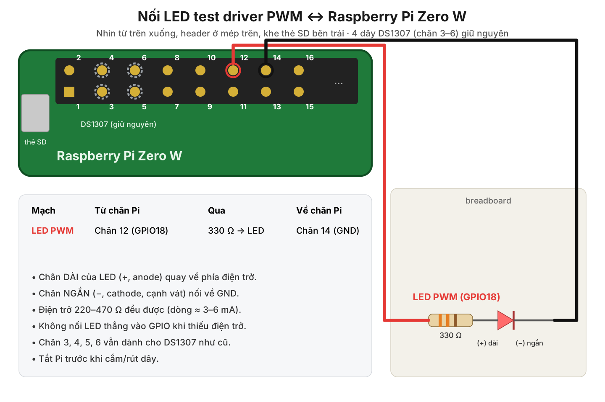

# Custom platform driver for the BCM2835 PWM block – Raspberry Pi Zero W

A **platform driver**: the device is **built into the SoC**, it is described by the **Device Tree**,
and the driver uses the `platform_driver` interface with `probe()` / `remove()`.

| | |
|---|---|
| Hardware | BCM2835 PWM block, `pwm@7e20c000`, 2 channels, 50 MHz clock |
| Driver | `bcm_pwm_plat.c` → `bcm_pwm_plat.ko` |
| Overlay | `bcm-pwm-plat-overlay.dts` → `bcm-pwm-plat.dtbo` |
| `compatible` | `"edu,bcm2835-pwm-plat"` |
| Interface | Standard Linux PWM framework: `/sys/class/pwm/pwmchip0` |
| Output | Channel 0 (PWM0) on **GPIO18, pin 12** |

**Relation to the Pi's own driver: this driver fully replaces `pwm-bcm2835`.** The Pi's Device Tree already
contains a `pwm@7e20c000` node (disabled by default) with `compatible = "brcm,bcm2835-pwm"`, which matches
the original `pwm-bcm2835` driver. This overlay **modifies that node directly**: it changes `compatible` to
our own string, enables the node and switches GPIO18 to its PWM function. The original driver no longer
matches and is not loaded, so the PWM block is controlled entirely by this driver.

| File | Role |
|---|---|
| `bcm_pwm_plat.c` | Driver code |
| `bcm-pwm-plat-overlay.dts` | Device Tree overlay (overrides the `&pwm` node) |
| `Makefile` | Builds the `.ko` module and the `.dtbo` overlay; `make install` |
| `README.md`, `wiring-led-pwm.png` | This guide and the wiring diagram (stay on the PC) |

---

## 1. Components

| Component | Qty |
|---|---|
| Raspberry Pi Zero W with soldered header, Raspberry Pi OS 32-bit | 1 |
| 5 mm LED | 1 |
| 330 Ω resistor (220–470 Ω also works) | 1 |
| Breadboard + 2 female–male jumper wires | |

No separate power supply, capacitor or transistor is needed: the LED draws only 3–6 mA, which a Pi GPIO can supply.

---

## 2. Wiring



| From Pi pin | Through | To Pi pin |
|---|---|---|
| **Pin 12** (GPIO18 = PWM0) | 330 Ω resistor → LED | **Pin 14** (GND) |

1. **Shut down the Pi and unplug it.**
2. Put the LED on the breadboard, each leg in its own row.
3. Identify the legs: **long leg = (+) anode**, **short leg = (−) cathode** (flat side of the plastic rim).
4. One end of the resistor goes in the same row as the long leg; the other end goes to **pin 12**. The short leg goes to **pin 14**.
5. Pins 12 and 14 are on the outer row of the header (pin 1 is the square pad, next to the SD-card slot; the outer row holds the even pins).
6. Check: LED the right way round, resistor in series, no wire on pins 2 or 4 (5 V).
7. Plug the power back in.

The four DS1307 wires (pins 3–6) and the Timer LED (pins 9, 11) can stay connected; there is no conflict.

**Test the LED before using the driver** (optional): `pinctrl set 18 op dh` turns the LED on, `pinctrl set 18 op dl` turns it off.
If it does not light, the LED is reversed or a wire is loose. **Reboot the Pi** after this test, before loading the driver
(the `pinctrl` command has switched pin 18 to a plain output).

---

## 3. Preparing Raspberry Pi OS

If this was already done for another driver (DS1307, Timer), only the `config.txt` check at the end of this section is needed.

```bash
sudo apt update
sudo apt full-upgrade -y
sudo reboot
# after the reboot:
sudo apt install -y build-essential device-tree-compiler linux-headers-rpi-v6
ls -d /lib/modules/$(uname -r)/build      # must exist
```

Check that `config.txt` does **not** enable the Pi's own PWM overlay, because it uses the same `&pwm` node:

```bash
grep -n -e "dtoverlay=pwm" -e "audremap" /boot/firmware/config.txt
```

No output is correct. If a line is printed, put a `#` at the start of that line to disable it.

---

## 4. Copying the code to the Pi

Only **3 files** are needed: `bcm_pwm_plat.c`, `bcm-pwm-plat-overlay.dts`, `Makefile`.

From the PC (on Windows, open PowerShell in the folder that contains the files):

```bash
ssh <user>@<hostname>.local "mkdir -p ~/PWM"
scp bcm_pwm_plat.c bcm-pwm-plat-overlay.dts Makefile <user>@<hostname>.local:~/PWM/
```

---

## 5. Build

```bash
cd ~/PWM
make
```

Output: `bcm_pwm_plat.ko` (kernel module) and `bcm-pwm-plat.dtbo` (compiled overlay).

---

## 6. Loading the overlay and the driver

### Method A (recommended): permanent installation

```bash
sudo make install
sudo nano /boot/firmware/config.txt
```

Add at the **end of the file** (below the `[all]` line):

```
dtoverlay=bcm-pwm-plat
```

Save and `sudo reboot`. At boot, udev runs `modprobe bcm_pwm_plat` from the `compatible` alias and `probe()` runs.
The LED stays off for now: the PWM only starts producing pulses when it is enabled in section 8.

### Method B: temporary loading without a reboot (lost after a reboot)

```bash
cd ~/PWM
sudo dtoverlay -d . bcm-pwm-plat
sudo insmod ./bcm_pwm_plat.ko
```

---

## 7. Checking that `probe()` ran

```bash
sudo dmesg | grep bcm-pwm-plat
```

```
bcm-pwm-plat 2020c000.pwm: PWM ready: 2 channels, clock 50000000 Hz (20 ns/tick), CTL=0x00000000
```

---

## 8. Testing the driver

Reading files in `/sys` needs no special rights, but **writing** them requires root. Every write therefore has the form:

```bash
echo <value> | sudo tee <file> > /dev/null
```

`sudo tee` writes the value with root rights; `> /dev/null` only stops `tee` from echoing the value.
Do **not** use `sudo echo <value> > <file>`: the `>` is handled by the normal user's shell before `sudo`
runs, so it still fails with `Permission denied`. `rmmod`, `modprobe`, `insmod` and `dmesg` also need `sudo`.

The variable `$P` (the driver's directory) is set in section 8.3 and `$C` (`/sys/class/pwm/pwmchip0`) in section 8.4.
In a new terminal, run the command that sets the variable again first.

The sample outputs below were produced by running exactly these commands on an emulated Pi Zero (section 12).
The error lines are shown as printed by the `tee` of Raspberry Pi OS (`tee: <file>: Invalid argument`);
the minimal `tee` of the emulated system prints `I/O error` instead of `Invalid argument`.

### 8.1 The custom driver has replaced the Pi's driver

```bash
cat /proc/device-tree/soc/pwm@7e20c000/compatible; echo
lsmod | grep -i pwm
ls /sys/bus/platform/drivers/bcm-pwm-plat/
```

```
edu,bcm2835-pwm-plat
bcm_pwm_plat 12288 0 - Live 0xbf006000 (O)
2020c000.pwm  bind  module  uevent  unbind
```

- The `pwm@7e20c000` node now carries our `compatible` (originally `brcm,bcm2835-pwm`).
- `lsmod` lists only `bcm_pwm_plat`, **not `pwm_bcm2835`**: the original driver is not loaded.
- The device `2020c000.pwm` is bound to the `bcm-pwm-plat` driver.

On the Pi, `lsmod` prints in columns (`bcm_pwm_plat  12288  0`); the content is the same.

### 8.2 GPIO18 has been switched to its PWM function

```bash
sudo sh -c 'grep "pin 18" /sys/kernel/debug/pinctrl/*/pinmux-pins'
```

```
pin 18 (gpio18): 2020c000.pwm (GPIO UNCLAIMED) function alt5 group gpio18
```

The command needs `sudo sh -c '...'` because only root can enter `/sys/kernel/debug`, even for the `*` to
expand to the file name. Newer kernels (6.18) print `pin 18 (gpio18): device 2020c000.pwm function alt5 group gpio18`,
which means the same.

The pinctrl entry in the overlay (`pinctrl-0 = <&pwm0_gpio18>`) has switched pin 18 to **ALT5 = PWM0** and
assigned it to the device `2020c000.pwm`. The driver core does this just before calling `probe()`.

### 8.3 Clock and initial registers

```bash
P=$(ls -d /sys/bus/platform/drivers/bcm-pwm-plat/*.pwm); cat $P/clock_hz; cat $P/regs
ls /sys/class/pwm/; cat /sys/class/pwm/pwmchip0/npwm
```

```
50000000
CTL=0x00000000 STA=0x00000000 RNG1=0 DAT1=0 RNG2=0 DAT2=0
pwmchip0
2
```

The PWM clock is 50 MHz (1 tick = 20 ns), taken from `assigned-clock-rates` in the Device Tree. The driver
registers one `pwmchip` with 2 channels. `regs` and `clock_hz` are two extra attributes added by the driver to
inspect the registers.

### 8.4 Output a 1 ms period (1 kHz), 25 % duty cycle

```bash
C=/sys/class/pwm/pwmchip0; echo 0 | sudo tee $C/export > /dev/null; ls $C/pwm0
echo 1000000 | sudo tee $C/pwm0/period > /dev/null; echo 250000 | sudo tee $C/pwm0/duty_cycle > /dev/null; echo 1 | sudo tee $C/pwm0/enable > /dev/null; cat $P/regs
```

```
capture  duty_cycle  enable  period  polarity  power  uevent
CTL=0x00000081 STA=0x00000000 RNG1=50000 DAT1=12500 RNG2=0 DAT2=0
```

**The LED lights dimly.** Register check:
- `RNG1 = 50000` = 1 000 000 ns / 20 ns: 1 ms period.
- `DAT1 = 12500` = 250 000 ns / 20 ns: 25 % high time.
- `CTL = 0x81` = bit 7 `MSEN` (mark-space mode) + bit 0 `PWEN` (channel 0 enabled).

### 8.5 Full brightness and off

```bash
echo 1000000 | sudo tee $C/pwm0/duty_cycle > /dev/null; cat $P/regs
echo 0 | sudo tee $C/pwm0/duty_cycle > /dev/null; cat $P/regs
```

```
CTL=0x00000081 STA=0x00000000 RNG1=50000 DAT1=50000 RNG2=0 DAT2=0
CTL=0x00000081 STA=0x00000000 RNG1=50000 DAT1=0 RNG2=0 DAT2=0
```

At 100 % duty (`DAT1 = RNG1`) the LED is at **full brightness**; at 0 % it is **off**.

### 8.6 Breathing LED (3 cycles)

```bash
for i in 1 2 3; do for d in $(seq 0 50000 1000000) $(seq 1000000 -50000 0); do echo $d | sudo tee $C/pwm0/duty_cycle > /dev/null; sleep 0.02; done; done; cat $P/regs
```

```
CTL=0x00000081 STA=0x00000000 RNG1=50000 DAT1=0 RNG2=0 DAT2=0
```

The LED "breathes": it fades in and out. Each step calls `sudo` once, so on the Pi Zero each cycle takes a few
seconds and the whole command runs for about 15–30 s. This is the clearest visual proof that the driver
controls the PWM block.

### 8.7 Inverting the polarity

```bash
echo 0 | sudo tee $C/pwm0/enable > /dev/null; echo inversed | sudo tee $C/pwm0/polarity > /dev/null; echo 250000 | sudo tee $C/pwm0/duty_cycle > /dev/null; echo 1 | sudo tee $C/pwm0/enable > /dev/null; cat $P/regs
echo 0 | sudo tee $C/pwm0/enable > /dev/null; echo normal | sudo tee $C/pwm0/polarity > /dev/null; echo 1 | sudo tee $C/pwm0/enable > /dev/null
```

```
CTL=0x00000091 STA=0x00000000 RNG1=50000 DAT1=12500 RNG2=0 DAT2=0
```

`CTL = 0x91`: bit 4 `POLA` is added. The duty cycle is still 25 %, but the signal is inverted, so **the LED is
much brighter** (75 % high time). The channel must be disabled before the polarity is changed (a PWM framework
rule). The second command restores normal polarity.

### 8.8 Rejecting a period that is too short

```bash
echo 0 | sudo tee $C/pwm0/duty_cycle > /dev/null; echo 20 | sudo tee $C/pwm0/period > /dev/null
cat $C/pwm0/period
```

```
tee: /sys/class/pwm/pwmchip0/pwm0/period: Invalid argument
1000000
```

20 ns is only one clock tick; the PWM block needs at least 2 ticks (40 ns). The driver's `apply()` returns
`-EINVAL` and the old period is kept.

### 8.9 `remove()` and `probe()`

The channel in use must be **unexported** before the driver is removed. While it is still exported, `rmmod`
reports that the module is in use (the kernel holds a reference to the module).

```bash
echo 0 | sudo tee $C/pwm0/enable > /dev/null; echo 0 | sudo tee $C/unexport > /dev/null; sudo rmmod bcm_pwm_plat; sudo dmesg | tail -n 1; ls /sys/class/pwm/ | wc -l
```

```
bcm-pwm-plat 2020c000.pwm: removing PWM (outputs will be switched off)
0
```

`remove()` ran, `pwmchip0` is gone and both channels are switched off (`CTL = 0`). Reload:

```bash
sudo modprobe bcm_pwm_plat            # Method A
# or: sudo insmod ./bcm_pwm_plat.ko   (Method B)
sudo dmesg | tail -n 1
```

```
bcm-pwm-plat 2020c000.pwm: PWM ready: 2 channels, clock 50000000 Hz (20 ns/tick), CTL=0x00000000
```

---

## 9. Uninstalling (restoring the Pi's original driver)

```bash
sudo nano /boot/firmware/config.txt     # delete the line dtoverlay=bcm-pwm-plat
cd ~/PWM && sudo make uninstall && make clean
sudo reboot
```

After the reboot the `&pwm` node is back to `compatible = "brcm,bcm2835-pwm"` (disabled, as by default).
To use the original PWM driver, add `dtoverlay=pwm`.

---

## 10. Troubleshooting

| Symptom | Cause / fix |
|---|---|
| `make`: `/lib/modules/.../build: No such file or directory` | `linux-headers-rpi-v6` not installed, or kernel and headers do not match (`full-upgrade`, then `reboot`). |
| `insmod: ... Invalid module format` | Module built for another kernel. Run `make clean && make` again after the reboot. |
| No `bcm-pwm-plat` line in `dmesg` | Overlay not applied. Check `cat /proc/device-tree/soc/pwm@7e20c000/compatible`. With Method B, run `dtoverlay` before `insmod`. |
| `lsmod` shows `pwm_bcm2835` but not `bcm_pwm_plat` | `config.txt` still contains `dtoverlay=pwm` or `pwm-2chan`. Disable that line and reboot. |
| `cannot get PWM clock` | The `&pwm` node has no `clocks` (wrong DTB for the Pi Zero). Check `ls /proc/device-tree/soc/pwm@7e20c000/`. |
| LED off although `regs` matches section 8.4 | LED reversed or wrong pin (must be **pin 12**). Check that section 8.2 shows `function alt5`. If `pinctrl set 18 ...` was used, reboot. |
| LED lights but the brightness does not change | Period too long (a few hundred ms or more), so the LED blinks instead of dimming. Use `period` ≤ 1 000 000 (1 ms). |
| `echo ... > duty_cycle: Invalid argument` | `duty_cycle` is larger than `period`. Set `period` first, then `duty_cycle`. |
| `rmmod bcm_pwm_plat`: module is in use | A PWM channel is still exported. Run `echo 0 \| sudo tee /sys/class/pwm/pwmchip0/unexport` and try again. |
| `... /sys/...: Permission denied` | Writing to `/sys` without root. Use `echo <value> \| sudo tee <file>`, not `echo ... > file` or `sudo echo ... > file`. |

---

## 11. Code explanation

### 11.1 Flow

```
config.txt: dtoverlay=bcm-pwm-plat        firmware merges the overlay into the Device Tree
        │
        ▼
Existing node /soc/pwm@7e20c000 after the overlay overrides it:
    compatible = "edu,bcm2835-pwm-plat";   // changed (original: "brcm,bcm2835-pwm")
    status     = "okay";                   // enabled (original: "disabled")
    pinctrl-0  = <&pwm0_gpio18>;           // added: GPIO18 ALT5
    reg, clocks, assigned-clock-rates      // kept from the Pi's original DTB
        │  kernel creates a platform_device; driver core applies pinctrl;
        │  udev modprobe from alias "of:...Cedu,bcm2835-pwm-plat"
        ▼
platform_driver_register()  ──compatible matches──►  probe(pdev)
        ├─ devm_platform_ioremap_resource()   → registers at 0x7e20c000
        ├─ devm_clk_get_enabled()             → 50 MHz PWM clock
        ├─ devm_add_action_or_reset(hw_off)   → switch-off action for removal
        └─ devm_pwmchip_add()                 → /sys/class/pwm/pwmchip0

echo ... > /sys/class/pwm/pwmchip0/pwm0/...  ──►  PWM framework  ──►  bcm_pwm_apply()
        └─ ns → 20 ns ticks; write RNG1, DAT1; set MSEN + PWEN in CTL

rmmod  ──►  remove()  ──►  devm (reverse order): remove pwmchip → hw_off (CTL = 0) → disable clock → unmap
```

### 11.2 Key technical points

| Point | Implementation |
|---|---|
| Overriding the original driver | The overlay modifies the **existing** `&pwm` node instead of adding a new one, so it reuses the `reg` and `clocks` declared by Raspberry Pi. Changing `compatible` is enough for the original driver to stop matching. |
| Resources from the DT | Registers (`reg`), clock (`clocks` + `assigned-clock-rates`) and output pin (`pinctrl`) all come from the Device Tree; no addresses are hard-coded. |
| Kernel integration | A `pwm_chip` is registered with the **PWM framework**, which provides the standard `/sys/class/pwm` interface usable by any Linux program. |
| `apply()` | Converts ns to clock ticks (`mul_u64_u64_div_u64`, no overflow), limits `duty ≤ period`, writes `RNGn`/`DATn`, sets `MSEN`+`PWEN` (+`POLA` when inverted). |
| `get_state()` | Converts the registers back to ns so the framework knows the real hardware state at registration. |
| Two channels share `CTL` | `CTL` is read-modified-written under a `spinlock` so channels 0 and 1 never overwrite each other's bits (both enabled gives `CTL = 0x8181`). |
| Removal order | The hardware switch-off action is registered **before** `devm_pwmchip_add()`, so on removal (reverse order) it runs **after** the `pwmchip` is gone: nothing can re-enable the PWM afterwards. |
| Kernel compatibility | Kernels ≥ 6.9 use `devm_pwmchip_alloc()`; older kernels embed `struct pwm_chip` in the private struct. `.remove` returns `void` since 6.11. |

---

## 12. Testing done

The code was tested with the **real Raspberry Pi kernel** (`raspberrypi/linux` sources, `bcmrpi_defconfig` for
Pi Zero / Zero W, ARMv6) on an **emulated Pi Zero** (QEMU 10.2, `raspi0` machine, with clock manager and pinctrl).
QEMU does not emulate the PWM block, so a simple register model was added to record every PWM register read/write
made by the driver. The driver was then run on the **real Raspberry Pi Zero W** (kernel 6.18.50+rpt-rpi-v6).

| Item | Result |
|---|---|
| Build with Pi kernels **6.6**, **6.12**, **6.18** (`W=1`) | No warnings |
| `checkpatch.pl` | 0 errors; only warnings about `LINUX_VERSION_CODE` (intentional, to support several kernel versions) |
| Overlay merged into `bcm2708-rpi-zero-w.dtb` (Raspberry Pi `dtmerge`) | `&pwm` node with new `compatible`, enabled, GPIO18 pinctrl |
| All commands of sections 7 → 8, in order, kernels 6.12 and 6.18 | Results as described |
| Overlay loaded at boot and at run time (configfs, as `dtoverlay` does) | `probe()` succeeds; removing the overlay at run time calls `remove()` |
| Register values | Match the datasheet: RNG/DAT in 20 ns ticks, CTL `0x81` / `0x91`, channel 1 shifted by 8 bits (`0x8100`), `rmmod` writes CTL = 0 |
| GPIO18 pin | pinctrl reports `function alt5`, owned by `2020c000.pwm` |
| Real Pi Zero W | LED dim at 25 % (section 8.4), breathing in section 8.6, brighter with inverted polarity |
