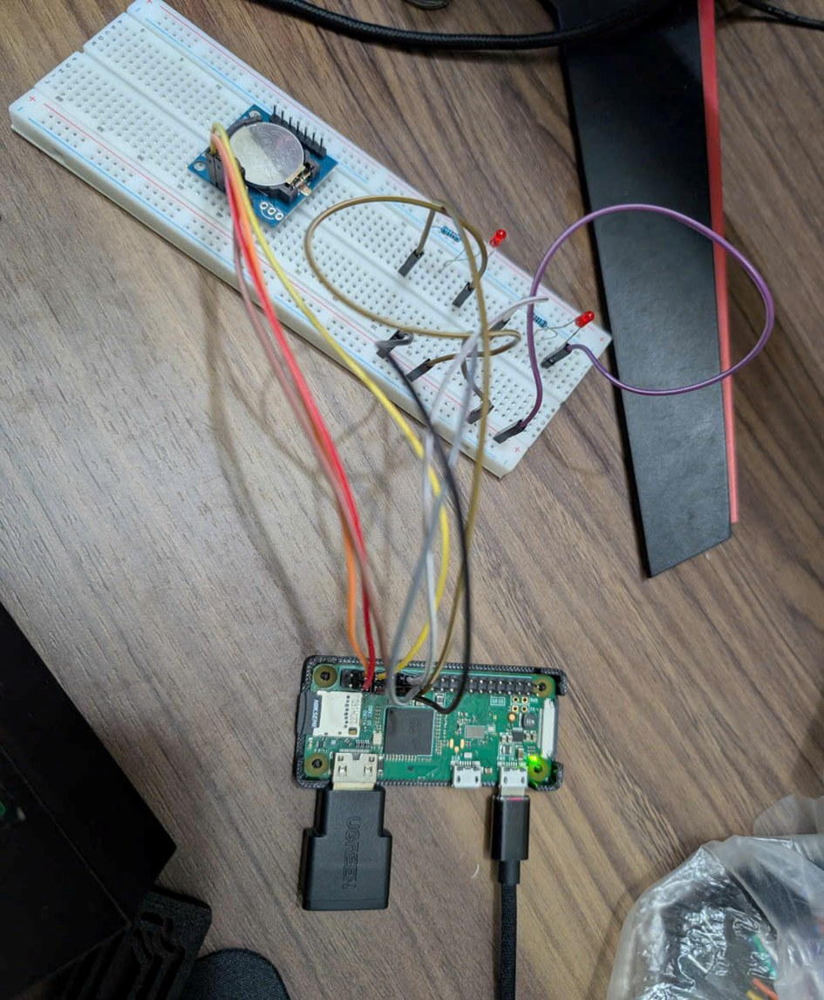

# Embedded-System – Linux Platform Drivers on the Raspberry Pi Zero W

**Course:** Embedded System Design · **Group 6** · **Lecturer:** Huỳnh Hoàng Hà

| No. | Member |
|-----|--------|
| 1 | Võ Trần Đăng Khoa |
| 2 | Phạm Trần Huy Hoàng |
| 3 | Huỳnh Anh Tuấn |

Three Linux **platform drivers**, each bound to its hardware through a **Device Tree overlay**,
written, built natively and tested on a Raspberry Pi Zero W (BCM2835, Raspberry Pi OS 32-bit,
kernel `6.18.50+rpt-rpi-v6`).

| Driver | Folder | Hardware | Result on the Pi |
|--------|--------|----------|------------------|
| Timer – `bcm_timer_plat` | [`Timer/`](Timer/) | BCM2835 System Timer, compare channel 1; LED on GPIO17 | 1 kHz interrupts, 0 missed periods, 31 µs worst-case latency |
| PWM – `bcm_pwm_plat` | [`PWM/`](PWM/) | BCM2835 PWM block (replaces `pwm-bcm2835`); LED on GPIO18 | Duty cycle and polarity match the registers and the LED |
| RTC – `ds1307_plat` | [`RTC/`](RTC/) | DS1307 on I2C1 with a CR2032 cell → `/dev/rtc0` | Time and NVRAM kept through a power loss of more than 10 min |

All **25 planned tests passed** (Timer 7/7, PWM 8/8, RTC 10/10).

## Repository structure

```
Embedded-System/
├── Timer/        bcm_timer_plat.c, bcm-timer-plat-overlay.dts, Makefile, README.md, wiring diagram
├── PWM/          bcm_pwm_plat.c, bcm-pwm-plat-overlay.dts, Makefile, README.md, wiring diagram
├── RTC/          ds1307_plat.c, ds1307-plat-overlay.dts, rtc_test.c, Makefile, README.md, wiring diagram
├── FinalReport/  report (PDF + Word) and presentation slides
├── VideoDemo/    links to the three demonstration videos
├── images/       evidence screenshots used in the report
└── README.md
```

Each driver folder has its own detailed step-by-step `README.md`: wiring, build,
loading, tests and troubleshooting.

## Hardware connection

| Device | Device pin | Pi header pin | Note |
|--------|-----------|---------------|------|
| LED (Timer) | Anode via 330 Ω | Pin 11 (GPIO17) | Cathode to pin 9 (GND) |
| LED (PWM) | Anode via 330 Ω | Pin 12 (GPIO18, ALT5 = PWM0) | Cathode to pin 14 (GND) |
| DS1307 module | VCC | Pin 4 (5 V) | Must be 5 V |
| DS1307 module | GND | Pin 6 (GND) | |
| DS1307 module | SDA | Pin 3 (GPIO2) | Pi's 1.8 kΩ pull-up to 3.3 V |
| DS1307 module | SCL | Pin 5 (GPIO3) | Pi's 1.8 kΩ pull-up to 3.3 V |



## Quick start (on the Raspberry Pi)

**1. Prepare the system (once)**

```bash
sudo apt update && sudo apt full-upgrade -y && sudo reboot
sudo apt install -y build-essential device-tree-compiler linux-headers-rpi-v6 i2c-tools
sudo raspi-config nonint do_i2c 0 && sudo reboot      # needed for the RTC only
```

**2. Timer** – LED on GPIO17 blinks every 0.5 s

```bash
cd Timer && make
sudo dtoverlay -d . bcm-timer-plat && sudo insmod ./bcm_timer_plat.ko
T=$(ls -d /sys/bus/platform/drivers/bcm-timer-plat/*.edu-timer)
echo 100000 | sudo tee $T/period_us > /dev/null      # 5 blinks per second
```

**3. PWM** – LED on GPIO18 at 25 % duty

```bash
cd PWM && make
sudo dtoverlay -d . bcm-pwm-plat && sudo insmod ./bcm_pwm_plat.ko
C=/sys/class/pwm/pwmchip0
echo 0       | sudo tee $C/export          > /dev/null
echo 1000000 | sudo tee $C/pwm0/period     > /dev/null
echo 250000  | sudo tee $C/pwm0/duty_cycle > /dev/null
echo 1       | sudo tee $C/pwm0/enable     > /dev/null
```

**4. RTC** – permanent installation, `/dev/rtc0`

```bash
cd RTC && make && sudo make install
# add to /boot/firmware/config.txt:  dtparam=i2c_arm=on  and  dtoverlay=ds1307-plat
sudo reboot
sudo ./rtc_test sync && sudo ./rtc_test read
```

**Unload:** `sudo rmmod bcm_timer_plat bcm_pwm_plat` (unexport the PWM channel first),
then `sudo dtoverlay -r bcm-timer-plat` and `sudo dtoverlay -r bcm-pwm-plat`.

## Video Demo

| Driver | Video |
|--------|-------|
| Timer | https://youtu.be/U_tcdEtAESg |
| PWM | https://youtu.be/Ros7_78uBJg |
| RTC – power-loss test | https://youtu.be/DzwE6CQ0-nE |

More details: [`VideoDemo/`](VideoDemo/).

## Final report

- Report: [`FinalReport/Group6_Platform_Driver_Report.pdf`](FinalReport/Group6_Platform_Driver_Report.pdf) (Word version in the same folder)
- Slides: [`FinalReport/Group6_Platform_Driver_Presentation.pptx`](FinalReport/Group6_Platform_Driver_Presentation.pptx)

Chapter 1 covers the theory (platform driver model, Device Tree, kernel frameworks);
Chapter 2 is a step-by-step guide for each driver with the test results.
