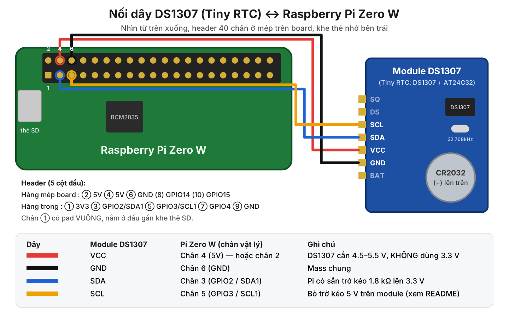

# Platform Driver cho RTC DS1307 trên Raspberry Pi Zero W

Hướng dẫn đầy đủ: lắp phần cứng trên breadboard → build code → nạp driver → chạy test.

| File | Nội dung |
|---|---|
| `ds1307_plat.c` | **Platform driver** (`platform_driver`, `probe()`, `remove()`), dùng Device Tree, đăng ký thiết bị RTC `/dev/rtcN` |
| `ds1307-plat-overlay.dts` | Device Tree overlay: bật I2C1 và khai báo node platform `ds1307-plat` |
| `Makefile` | Build module `.ko`, overlay `.dtbo`, chương trình test; `make install` |
| `rtc_test.c` | Chương trình test user-space: đọc/ghi RTC bằng `ioctl(RTC_RD_TIME / RTC_SET_TIME)` |
| `wiring.svg`, `wiring.png` | Sơ đồ nối dây |

---

## 1. Linh kiện cần có

| Linh kiện | Ghi chú |
|---|---|
| Raspberry Pi Zero W | Đã **hàn header 40 chân** (bản Zero W không kèm sẵn header; bản Zero WH thì có). Tối thiểu cần hàn chân 1–6. |
| Thẻ microSD ≥ 8 GB | Cài Raspberry Pi OS **32-bit** (Pi Zero W là ARMv6, không chạy được bản 64-bit) |
| Nguồn 5 V – 2 A micro-USB | Cắm vào cổng **PWR IN** |
| Module RTC DS1307 (loại "Tiny RTC", có DS1307 + EEPROM AT24C32) | |
| Pin CR2032 3 V | |
| Breadboard + 4 dây jumper **cái–đực** (female–male) | Đỏ, đen, xanh dương, vàng cho dễ nhận biết |
| Đồng hồ vạn năng | Để kiểm tra module trước khi nối vào Pi |
| (Tùy chọn) LED + điện trở 1 kΩ | Để test chân SQW (xung vuông 1 Hz) |
| (Tùy chọn) Mỏ hàn, hút thiếc | Nếu module cần sửa (mục 3) |

---

## 2. Trả lời nhanh: có cần trở / tụ / nguồn riêng không?

**Cấp nguồn riêng cho DS1307? KHÔNG cần.**
Lấy 5 V trực tiếp từ chân 4 (hoặc chân 2) của Pi. DS1307 tiêu thụ tối đa khoảng 1.5 mA. Nếu bạn vẫn dùng nguồn 5 V ngoài thì **bắt buộc nối chung GND** với Pi.

**Phải cấp 5 V, không cấp 3.3 V.**
DS1307 cần VCC từ 4.5 V đến 5.5 V. Nó so VCC với điện áp pin: khi VCC < 1.25 × VBAT (≈ 3.75 V với pin 3 V), chip **khóa giao tiếp I2C**. Nếu cấp 3.3 V, `i2cdetect` sẽ không thấy chip.

**Logic I2C 3.3 V của Pi có đủ cho chip chạy 5 V không? Có.**
DS1307 nhận mức "1" từ 2.2 V trở lên, nên 3.3 V của Pi là đủ. Không cần mạch chuyển mức (level shifter), **với điều kiện** đường SDA/SCL không bị kéo lên 5 V (xem dưới).

**Điện trở kéo lên (pull-up) cho SDA/SCL? KHÔNG cần thêm.**
GPIO2/GPIO3 của Pi đã có sẵn trở kéo 1.8 kΩ lên 3.3 V trên board. Vấn đề ngược lại: module Tiny RTC thường có sẵn 2 trở 3.3 kΩ kéo SDA/SCL lên **5 V**. GPIO của Pi **không chịu được 5 V**. Phải bỏ 2 trở này (mục 3.2).

**Tụ điện? KHÔNG cần.**
Module đã có tụ lọc nguồn 100 nF. Chỉ khi tự lắp chip DS1307 rời mới cần (mục 4.4).

**Pin CR2032 dùng được trên module Tiny RTC không? Có, nhưng phải bỏ mạch sạc.**
Module Tiny RTC thiết kế cho pin **sạc** LIR2032 nên có mạch sạc pin từ 5 V. CR2032 là pin **không sạc được**: bị sạc sẽ nóng, phồng, có thể chảy hoặc nổ. Phải kiểm tra và bỏ mạch sạc (mục 3.1).

---

## 3. Kiểm tra (và sửa nếu cần) module TRƯỚC khi nối vào Pi

Các tên linh kiện R2, R3, D1… dưới đây theo board Tiny RTC phổ biến. Bản clone có thể đánh số khác, nên **luôn đo để xác nhận**, đừng chỉ dựa vào tên in trên board.

Cách cấp nguồn để đo: chưa lắp pin, chưa nối SDA/SCL. Chỉ nối **VCC module → chân 4 (5 V)** và **GND module → chân 6 (GND)** của Pi rồi bật Pi. Có thể dùng nguồn 5 V bất kỳ khác.

### 3.1 Kiểm tra mạch sạc pin (BẮT BUỘC khi dùng CR2032)

- Đo điện áp giữa **cực + của đế pin** (lá kim loại phía trên) và **GND**, khi chưa lắp pin.
- **≈ 0 V**: module không có mạch sạc, dùng CR2032 bình thường.
- **Vài vôn (thường 3–4.5 V)**: có mạch sạc. Tắt nguồn và tháo **diode D1** (diode nhỏ, thường là 1N4148, gần đế pin). Tháo D1 là đủ để cắt đường sạc.
- Cách sửa đầy đủ hay được dùng cho Tiny RTC: tháo D1, R4, R5, R6 rồi **nối tắt 2 pad của R6**. Cách này loại luôn cầu phân áp làm pin hao. Chỉ làm khi board của bạn đúng là Tiny RTC.
- Đo lại sau khi sửa: phải còn **≈ 0 V**.

Không muốn hàn thì thay CR2032 bằng pin sạc **LIR2032** và giữ nguyên module.

### 3.2 Kiểm tra trở kéo lên 5 V trên SDA/SCL (BẮT BUỘC trước khi nối vào Pi)

- Vẫn cấp 5 V như trên, **SDA/SCL chưa nối Pi**.
- Đo điện áp **SDA–GND** và **SCL–GND**.
- **≈ 0 V hoặc chập chờn**: không có trở kéo, nối thẳng vào Pi được.
- **≈ 5 V**: có trở kéo lên 5 V. Tắt nguồn và tháo 2 trở kéo. Trên Tiny RTC thường là **R2 và R3**, giá trị 3.3 kΩ (mã in **332**). Mỗi trở có một đầu nối với SDA (hoặc SCL), đầu kia nối VCC. Có thể đo thông mạch để tìm.
- Không muốn tháo trở thì dùng module chuyển mức I2C 2 chiều (BSS138) giữa Pi (3.3 V) và module (5 V).
- Đo lại sau khi sửa: phải **≈ 0 V**. Khi nối vào Pi, đường SDA/SCL sẽ nằm ở 3.3 V nhờ trở của Pi.

Vì sao quan trọng: nếu giữ trở 3.3 kΩ lên 5 V song song với trở 1.8 kΩ lên 3.3 V của Pi, đường I2C nghỉ ở khoảng 3.9 V. Mức này vượt giới hạn tuyệt đối 3.6 V của GPIO, dễ làm hỏng chân GPIO2/3 về lâu dài.

### 3.3 Lắp pin

- Tắt nguồn. Lắp CR2032 vào đế, **mặt có dấu (+) hướng lên trên** (ra ngoài).
- Đo pin: phải từ khoảng 2.8 V đến 3.3 V. Dưới 2 V thì DS1307 không giữ được giờ khi mất điện.

---

## 4. Sơ đồ chân và lắp trên breadboard



### 4.1 Bảng nối dây

| Màu dây | Chân module DS1307 | Chân vật lý trên Pi Zero W | Tên chân Pi | Ghi chú |
|---|---|---|---|---|
| Đỏ | **VCC** | **Chân 4** (hoặc chân 2) | 5V | KHÔNG nối vào chân 1 (3.3 V) |
| Đen | **GND** | **Chân 6** | GND | |
| Xanh dương | **SDA** | **Chân 3** | GPIO2 / SDA1 | Bus I2C1, `/dev/i2c-1` |
| Vàng | **SCL** | **Chân 5** | GPIO3 / SCL1 | |
| — | SQ, DS, BAT | Không nối | | SQ chỉ dùng khi test xung vuông (mục 9.7) |

Bốn chân 3, 4, 5, 6 của Pi nằm liền nhau thành một khối 2×2, rất khó nhầm.

### 4.2 Xác định chân trên header Pi Zero W

```
Nhìn từ trên xuống, header ở mép trên board, khe thẻ SD ở bên trái:

 hàng sát mép board →   2      4      6      8      10    ...  40
                        5V     5V     GND    GPIO14 GPIO15
 hàng phía trong    →   ■1     3      5      7      9     ...  39
                        3V3    SDA1   SCL1   GPIO4  GND
                               GPIO2  GPIO3
```

- Chân 1 có **pad hàn hình vuông**, nằm ở đầu header **gần khe thẻ SD**.
- Hàng sát mép board là các chân chẵn (2, 4, 6…); hàng phía trong là các chân lẻ (1, 3, 5…).
- Chân 2 và chân 4 đều là 5 V. Chân 6 là GND.

### 4.3 Các bước lắp

1. **Tắt Pi và rút nguồn.**
2. Hàn header thẳng vào hàng chân **P1** (7 chân: SQ, DS, SCL, SDA, VCC, GND, BAT) của module, nếu chưa có.
3. Cắm module lên breadboard sao cho **mỗi chân nằm trên một hàng dọc khác nhau** của breadboard. Không cắm 2 chân vào cùng một dải 5 lỗ nối thông.
4. Cắm đầu **đực** của 4 dây jumper vào cùng hàng breadboard với chân VCC, GND, SDA, SCL của module.
5. Cắm đầu **cái** vào header Pi theo bảng 4.1, mỗi lần một dây, và đối chiếu số chân.
6. **Kiểm tra lại trước khi cấp điện:**
   - Dây đỏ ở chân 4 (5 V), không phải chân 1 (3.3 V).
   - Dây đen ở chân 6 (GND).
   - SDA ở chân 3, SCL ở chân 5. Đảo nhau thì không hư nhưng chip sẽ không trả lời.
   - Không có chân nào của module chạm nhau trên breadboard.
7. Cắm nguồn vào cổng **PWR IN** của Pi.

Có thể bỏ breadboard và dùng 4 dây **cái–cái** nối thẳng từ module sang Pi; sơ đồ nối giữ nguyên.

### 4.4 Nếu dùng chip DS1307 rời (DIP-8) thay cho module

| Chân DS1307 | Nối tới |
|---|---|
| 1 X1, 2 X2 | Thạch anh **32.768 kHz** (tải 12.5 pF), đặt sát chip, không cần tụ |
| 3 VBAT | Cực + pin CR2032 (cực − về GND). Không dùng pin thì nối VBAT xuống GND |
| 4 GND | GND (chân 6 của Pi) |
| 5 SDA | Chân 3 của Pi (không cần trở kéo, Pi đã có 1.8 kΩ lên 3.3 V) |
| 6 SCL | Chân 5 của Pi |
| 7 SQW/OUT | Để trống, hoặc trở kéo 10 kΩ lên 3.3 V nếu dùng (ngõ ra cực máng hở) |
| 8 VCC | 5 V (chân 4 của Pi) + **tụ 100 nF** từ VCC xuống GND, đặt sát chân chip |

---

## 5. Chuẩn bị Raspberry Pi OS

1. Dùng **Raspberry Pi Imager** ghi **Raspberry Pi OS Lite (32-bit)** lên thẻ. Trong phần cài đặt nâng cao, đặt hostname, user/mật khẩu, Wi-Fi, và bật SSH.
2. Khởi động Pi, SSH vào: `ssh <user>@<hostname>.local`
3. Cập nhật và **khởi động lại**, để kernel đang chạy khớp với kernel headers sẽ cài:

```bash
sudo apt update
sudo apt full-upgrade -y
sudo reboot
```

4. Cài công cụ build, kernel headers, `dtc`, i2c-tools:

```bash
sudo apt install -y build-essential device-tree-compiler i2c-tools linux-headers-rpi-v6
# Ảnh OS cũ (Bullseye trở về trước) dùng: sudo apt install -y raspberrypi-kernel-headers
```

5. Kiểm tra headers đúng phiên bản kernel đang chạy:

```bash
uname -r                              # ví dụ: 6.12.x+rpt-rpi-v6
ls -d /lib/modules/$(uname -r)/build  # phải tồn tại
```

Nếu thư mục `build` không tồn tại, kernel và headers lệch phiên bản. Chạy lại bước 3 (`full-upgrade` rồi `reboot`).

6. Nếu chưa có lệnh `hwclock`: `sudo apt install -y util-linux-extra`

---

## 6. Kiểm tra phần cứng bằng i2c-tools (trước khi dùng driver)

Bước này xác nhận dây nối đúng, độc lập với driver.

```bash
sudo raspi-config nonint do_i2c 0   # bật I2C (tương đương dtparam=i2c_arm=on)
sudo reboot
```

Sau khi khởi động lại:

```bash
ls /dev/i2c-1
sudo i2cdetect -y 1
```

Kết quả đúng là có **68** (DS1307). Module Tiny RTC còn có **50** (EEPROM AT24C32):

```
     0  1  2  3  4  5  6  7  8  9  a  b  c  d  e  f
00:                         -- -- -- -- -- -- -- --
...
50: 50 -- -- -- -- -- -- -- -- -- -- -- -- -- -- --
60: -- -- -- -- -- -- -- -- 68 -- -- -- -- -- -- --
70: -- -- -- -- -- -- -- --
```

Đọc thử thanh ghi giây:

```bash
sudo i2cget -y 1 0x68 0x00
```

- Kết quả `0x80` hoặc lớn hơn: bit CH = 1, bộ dao động đang dừng (pin mới lắp, bình thường). Driver sẽ chạy lại khi bạn đặt giờ.
- Đọc 2 lần cách nhau vài giây mà giá trị thay đổi: chip đang đếm giờ.

Không thấy `68`: xem mục 13 (Xử lý lỗi). **Đừng sang bước sau** khi chưa thấy `68`.

> **Quan trọng:** KHÔNG được có dòng `dtoverlay=i2c-rtc,ds1307` trong `config.txt`. Dòng đó nạp driver `rtc-ds1307` có sẵn của kernel, chiếm địa chỉ 0x68, và driver của chúng ta sẽ báo `-EBUSY`.

---

## 7. Build code

Chỉ cần chép **4 file** lên Pi. `README.md`, `wiring.png`, `wiring.svg` là tài liệu, giữ lại trên máy tính.

| File | Vai trò |
|---|---|
| `ds1307_plat.c` | Driver (phía `platform_driver`: `of_match_table`, `probe()`, `remove()`) |
| `ds1307-plat-overlay.dts` | Device Tree overlay (phía thiết bị: `compatible = "edu,ds1307-platform"`) |
| `Makefile` | Build cả hai file trên và `rtc_test` |
| `rtc_test.c` | Chương trình test dùng ở mục 9 và 10 |

Từ máy tính (Windows thì mở PowerShell trong thư mục chứa các file):

```bash
ssh <user>@<hostname>.local "mkdir -p ~/ds1307-platform-driver"
scp ds1307_plat.c ds1307-plat-overlay.dts Makefile rtc_test.c <user>@<hostname>.local:~/ds1307-platform-driver/
```

Nếu bạn đã mở `Makefile` bằng một trình soạn thảo trên Windows và lưu lại, hãy chạy thêm `sed -i 's/\r$//' Makefile` trên Pi để bỏ ký tự xuống dòng kiểu Windows.

Trên Pi:

```bash
cd ~/ds1307-platform-driver
make
```

Kết quả tạo ra 3 file:

| File | Ý nghĩa |
|---|---|
| `ds1307_plat.ko` | Kernel module (platform driver) |
| `ds1307-plat.dtbo` | Device Tree overlay đã biên dịch |
| `rtc_test` | Chương trình test user-space |

Build trên Pi Zero W mất khoảng 1–2 phút. Kiểm tra module:

```bash
modinfo ds1307_plat.ko
# alias: of:N*T*Cedu,ds1307-platform...  vermagic: phải khớp uname -r
```

---

## 8. Nạp overlay và driver

### Cách A (khuyên dùng): cài cố định, tự nạp khi khởi động

```bash
sudo make install
```

Lệnh này chép `ds1307_plat.ko` vào `/lib/modules/$(uname -r)/extra/`, chạy `depmod`, và chép `ds1307-plat.dtbo` vào `/boot/firmware/overlays/` (ảnh OS cũ: `/boot/overlays/`).

Sửa file cấu hình boot:

```bash
sudo nano /boot/firmware/config.txt      # ảnh OS cũ: /boot/config.txt
```

Thêm vào **cuối file**, dưới dòng `[all]` (dòng `dtparam=i2c_arm=on` có thể đã được raspi-config thêm ở mục 6; có rồi thì không cần thêm lại):

```
dtparam=i2c_arm=on
dtoverlay=ds1307-plat
```

Lưu và khởi động lại: `sudo reboot`

Khi khởi động, firmware ghép overlay vào Device Tree, kernel tạo platform device `ds1307-plat`. Nhờ `MODULE_DEVICE_TABLE(of, ...)`, udev tự `modprobe ds1307_plat` và hàm `probe()` chạy.

### Cách B: nạp tạm, không cần khởi động lại

Dùng khi đang thử nghiệm. Mất sau khi reboot.

```bash
cd ~/ds1307-platform-driver
sudo dtoverlay -d . ds1307-plat     # nạp overlay lúc chạy (qua configfs)
sudo insmod ./ds1307_plat.ko        # nạp driver -> probe()
```

Gỡ: `sudo rmmod ds1307_plat` (gọi `remove()`), rồi `sudo dtoverlay -r ds1307-plat`.

### Kiểm tra driver đã chạy

```bash
dmesg | grep ds1307-plat
```

Kết quả mong đợi:

```
ds1307-plat ds1307-plat: DS1307 found at 0x68 on i2c-1, regs: 27 31 14 07 10 10 26 00
ds1307-plat ds1307-plat: registered as rtc0
ds1307-plat ds1307-plat: setting system clock to 2026-10-10T14:31:27 UTC (1791642687)
```

Dòng thứ 3 nghĩa là kernel đã tự lấy giờ từ RTC đặt cho hệ thống (mục 11). Nếu pin mới lắp, sẽ có thêm dòng `oscillator is stopped ...`: đặt giờ một lần bằng `sudo hwclock -w` là xong.

Các lệnh kiểm tra khác:

```bash
ls /sys/bus/platform/drivers/ds1307-plat/   # thấy "ds1307-plat" -> đã bind
cat /sys/class/rtc/rtc0/name                # ds1307-plat ds1307-plat
sudo i2cdetect -y 1                         # ô 68 hiện "UU" (địa chỉ đã bị driver chiếm)
```

Pi Zero W không có RTC nào khác nên thiết bị thường là `/dev/rtc0`. Các lệnh test tự dò đúng tên, không phụ thuộc số thứ tự.

---

## 9. Kiểm thử driver (từng bước bằng tay)

Mọi lệnh chạy trong thư mục code trên Pi (`cd ~/ds1307-platform-driver`). Kết quả mẫu bên dưới lấy từ lần chạy đúng các lệnh này, theo đúng thứ tự, trên Pi Zero giả lập (mục 15). Riêng byte "thứ trong tuần" đã được ghi theo giá trị chip thật trả về; chip giả lập đọc lại byte này sai, xem ghi chú ở mục 15. Giờ in ra trên Pi của bạn tất nhiên sẽ khác.

RTC luôn lưu giờ **UTC**. `rtc_test` in giờ UTC; `hwclock -r` in theo múi giờ của Pi (đặt múi giờ Việt Nam: `sudo timedatectl set-timezone Asia/Ho_Chi_Minh`).

Trước khi test, cho Pi kết nối mạng để giờ hệ thống đúng: `timedatectl` phải hiện `System clock synchronized: yes`.

### 9.1 Driver đã `probe()` thành công

```bash
ls /sys/bus/platform/drivers/ds1307-plat/
cat /sys/class/rtc/rtc0/name
ls /dev/rtc*
```

```
bind  ds1307-plat  module  uevent  unbind
ds1307-plat ds1307-plat
/dev/rtc0
```

Có thư mục `ds1307-plat` trong danh sách đầu tiên nghĩa là platform device (tạo từ Device Tree) đã được gắn với driver.

### 9.2 Đọc giờ

```bash
sudo ./rtc_test read
sudo hwclock -r
```

```
2026-10-12 09:54:09 UTC (Mon) epoch=1791798849
```

Dòng thứ hai (`hwclock -r`) in cùng thời điểm đó theo múi giờ của Pi. Giờ in ra phải khớp giờ thật (`rtc_test` in giờ UTC, tức giờ Việt Nam trừ 7).

### 9.3 Ghi giờ, đồng hồ chạy, chuyển năm

```bash
sudo ./rtc_test set "2030-12-31 23:59:58"
sudo ./rtc_test watch 4
```

```
set ok, now: 2030-12-31 23:59:58 UTC (Wed) epoch=1924991998
2030-12-31 23:59:58 UTC (Wed) epoch=1924991998
2030-12-31 23:59:59 UTC (Wed) epoch=1924991999
2031-01-01 00:00:00 UTC (Thu) epoch=1924992000
2031-01-01 00:00:01 UTC (Thu) epoch=1924992001
```

Kiểm tra được 3 điều cùng lúc: ghi giờ thành công, chip đang đếm (mỗi dòng tăng 1 giây), và chuyển sang năm mới đúng (cả thứ trong tuần cũng đổi từ Wed sang Thu).

### 9.4 Năm nhuận

```bash
sudo ./rtc_test set "2028-02-28 23:59:59"
sleep 2; sudo ./rtc_test read
```

```
set ok, now: 2028-02-28 23:59:59 UTC (Sat) epoch=1835395199
2028-02-29 00:00:01 UTC (Sun) epoch=1835395201
```

Năm 2028 là năm nhuận nên sau ngày 28/02 phải là 29/02, không phải 01/03.

### 9.5 Từ chối thời gian ngoài phạm vi

DS1307 chỉ lưu 2 chữ số năm (00–99), driver khai báo phạm vi 2000–2099.

```bash
sudo ./rtc_test set "2100-01-01 00:00:00"
sudo ./rtc_test set "1999-12-31 23:59:59"
```

```
RTC_SET_TIME: Numerical result out of range
RTC_SET_TIME: Numerical result out of range
```

Báo lỗi là **đúng**: rtc core chặn giá trị ngoài phạm vi (`-ERANGE`) trước khi gọi `set_time()` của driver.

### 9.6 Thanh ghi BCD

```bash
sudo ./rtc_test set "2026-10-10 20:35:00"
cat /sys/class/rtc/rtc0/regs
```

```
set ok, now: 2026-10-10 20:35:00 UTC (Sat) epoch=1791664500
00 35 20 07 10 10 26 00
```

Ý nghĩa 8 byte (thanh ghi 0x00 → 0x07, dạng BCD nên đọc thẳng như số thập phân):

```
00 35 20 07 10 10 26 00
 |  |  |  |  |  |  |  └ control (SQW tắt)
 |  |  |  |  |  |  └ năm 26
 |  |  |  |  |  └ tháng 10
 |  |  |  |  └ ngày 10
 |  |  |  └ thứ (1 = CN … 7 = T7; ngày 10/10/2026 là thứ Bảy)
 |  |  └ giờ 20 (bit6 = 0: chế độ 24h)
 |  └ phút 35
 └ giây 00 (bit7 = CH = 0: bộ dao động đang chạy)
```

Giây có thể là `01`, `02` nếu bạn gõ lệnh thứ hai chậm.

### 9.7 Xung vuông SQW

```bash
echo 1 | sudo tee /sys/class/rtc/rtc0/sqw
cat /sys/class/rtc/rtc0/sqw
cat /sys/class/rtc/rtc0/regs
echo off | sudo tee /sys/class/rtc/rtc0/sqw
```

```
1
1
00 35 20 07 10 10 26 10
off
```

Byte cuối (thanh ghi control) đổi từ `00` sang `10`: bit SQWE = 1, RS = 00 → 1 Hz. Giá trị hợp lệ: `off`, `1`, `4096`, `8192`, `32768`. Ghi giá trị khác (ví dụ `1234`) sẽ bị từ chối với lỗi `Invalid argument`.

Muốn **nhìn thấy** xung (tùy chọn): tắt nguồn, nối **chân 1 của Pi (3.3 V) → điện trở 1 kΩ → chân dài LED → chân ngắn LED → chân SQ của module**. Bật lại, `echo 1 | sudo tee /sys/class/rtc/rtc0/sqw` thì LED nháy 1 lần/giây. SQW là ngõ ra cực máng hở nên LED sáng khi SQW ở mức thấp.

### 9.8 NVRAM 56 byte (giữ được khi mất điện nhờ pin)

```bash
NV=$(ls /sys/bus/nvmem/devices/ds1307_nvram*/nvmem)
echo "Xin chao DS1307" | sudo dd of=$NV bs=56 count=1 status=none
sudo hexdump -C $NV
```

```
00000000  58 69 6e 20 63 68 61 6f  20 44 53 31 33 30 37 0a  |Xin chao DS1307.|
00000010  00 00 00 00 00 00 00 00  00 00 00 00 00 00 00 00  |................|
*
00000030  00 00 00 00 00 00 00 00                           |........|
00000038
```

Dung lượng đúng 0x38 = 56 byte (thanh ghi 0x08–0x3F của DS1307). Chuỗi này vẫn còn sau khi rút điện ở mục 10.

### 9.9 Trả RTC về giờ đúng (BẮT BUỘC trước bước 9.10)

```bash
sudo ./rtc_test sync
sudo ./rtc_test diff
```

```
synced from system time: 2026-10-12 09:54:16 UTC (Mon) epoch=1791798856
0
```

`diff` là độ lệch RTC so với giờ hệ thống, tính bằng giây: `0` hoặc `±1` là đạt. Có thể dùng `sudo hwclock -w` thay cho `rtc_test sync`.

> Vì sao bắt buộc: mỗi lần driver đăng ký `rtc0`, kernel đặt giờ hệ thống theo RTC. Nếu RTC còn giữ giờ test (ví dụ năm 2030) mà bạn làm bước 9.10, giờ của Pi sẽ nhảy sang năm 2030 cho tới khi NTP sửa lại.

### 9.10 `remove()` và `probe()`: gỡ rồi nạp lại driver

```bash
sudo rmmod ds1307_plat
ls /dev/rtc*
dmesg | tail -n 1
```

```
ls: cannot access '/dev/rtc*': No such file or directory
ds1307-plat ds1307-plat: removing rtc0
```

`remove()` đã chạy, `/dev/rtc0` biến mất. Chờ vài giây rồi nạp lại:

```bash
sudo modprobe ds1307_plat        # nếu cài bằng Cách A (make install)
# hoặc: sudo insmod ./ds1307_plat.ko   (Cách B)
dmesg | grep ds1307-plat | tail -n 3
sudo ./rtc_test diff
```

```
ds1307-plat ds1307-plat: DS1307 found at 0x68 on i2c-1, regs: 20 54 09 02 12 10 26 00
ds1307-plat ds1307-plat: registered as rtc0
ds1307-plat ds1307-plat: setting system clock to 2026-10-12T09:54:20 UTC (1791798860)
0
```

`probe()` chạy lại, `/dev/rtc0` xuất hiện lại. Dãy `regs` là giờ chip đang giữ (09:54:20, thứ Hai 12/10/26), và `diff` vẫn ≈ 0: chip DS1307 vẫn đếm giờ trong lúc không có driver.

Nếu `rmmod` báo `Module ds1307_plat is in use`, một chương trình đang mở `/dev/rtc0` (thường là `hwclock` đang chạy). Đợi vài giây rồi thử lại.

---

## 10. Test giữ giờ khi mất điện (quan trọng nhất)

1. Đảm bảo RTC đúng giờ: `sudo ./rtc_test sync`, rồi `sudo ./rtc_test read`. Nếu đã ghi chuỗi NVRAM ở mục 9.8 thì giữ nguyên để kiểm tra luôn.
2. Tắt máy: `sudo poweroff`. Chờ đèn ACT tắt hẳn rồi **rút nguồn**.
3. Chờ **ít nhất 10 phút**. Pin CR2032 nuôi DS1307 trong lúc này.
4. Cắm nguồn, SSH vào, chạy **ngay**:

```bash
sudo ./rtc_test read     # giờ RTC: phải bằng giờ thật (so với điện thoại, theo UTC)
sudo ./rtc_test diff     # sau khi NTP đồng bộ: lệch 0..2 giây
sudo hexdump -C /sys/bus/nvmem/devices/ds1307_nvram*/nvmem   # chuỗi "Xin chao DS1307" vẫn còn
```

Nếu RTC hiện giờ đúng tức là chip đã đếm giờ bằng pin suốt thời gian mất điện. **Test đạt.** Có thể mở `dmesg | grep ds1307-plat` để thấy dòng `setting system clock to ...`: lúc khởi động, khi chưa có mạng, Pi đã lấy giờ từ DS1307.

Test thêm (tùy chọn) – mô phỏng pin hết: tắt nguồn, **tháo pin**, chờ 1 phút, cắm lại nguồn (chưa lắp pin). Thường DS1307 sẽ dừng dao động (bit CH = 1); khi đó:

```
$ dmesg | grep ds1307-plat
ds1307-plat ds1307-plat: oscillator is stopped (new/empty battery?): set the time with 'hwclock -w'
$ sudo ./rtc_test read
RTC_RD_TIME: Invalid argument
```

Driver không trả về giờ sai mà báo lỗi. Đặt lại giờ bằng `sudo ./rtc_test sync` (xóa bit CH, chip chạy lại), rồi tắt máy và lắp pin vào. Nếu chip vẫn đọc ra giờ (không báo lỗi) thì chỉ là giờ không còn đúng, cũng là kết quả bình thường.

Độ chính xác của DS1307 phụ thuộc thạch anh, thường lệch vài giây mỗi ngày.

---

## 11. Lấy giờ từ RTC khi khởi động không có mạng

Không cần cấu hình thêm. Kernel Raspberry Pi bật `CONFIG_RTC_HCTOSYS` với thiết bị `rtc0`. Khi driver đăng ký `rtc0` lúc khởi động, rtc core tự đặt giờ hệ thống từ RTC; đó là dòng `setting system clock to ...` trong `dmesg`. Pi Zero W không có RTC nào khác nên DS1307 luôn là `rtc0`.

Chiều ngược lại cũng tự động: khi có mạng và NTP đã đồng bộ, kernel ghi giờ hệ thống vào `rtc0` mỗi 11 phút (`CONFIG_RTC_SYSTOHC`).

Gói `fake-hwclock` của Pi OS có thể giữ nguyên. Nó chỉ đặt giờ khi giờ đã lưu mới hơn giờ hiện tại, nên không ghi đè giờ đúng từ RTC.

---

## 12. Gỡ cài đặt

```bash
sudo nano /boot/firmware/config.txt      # xóa dòng dtoverlay=ds1307-plat
cd ~/ds1307-platform-driver && sudo make uninstall && make clean
sudo reboot
```

---

## 13. Xử lý lỗi thường gặp

| Hiện tượng | Nguyên nhân / Cách sửa |
|---|---|
| `i2cdetect` không thấy `68` | VCC đang ở 3.3 V thay vì 5 V; SDA/SCL đảo nhau; dây lỏng; I2C chưa bật (`ls /dev/i2c-1`); hàn header Pi bị hở; pin > VCC/1.25. Đo VCC–GND trên module phải ≈ 5 V. |
| Thấy `50` nhưng không thấy `68` | Chip DS1307 hỏng hoặc thạch anh hỏng (hiếm), hoặc VCC quá thấp |
| `dmesg`: `no DS1307 answering at 0x68 ... err -121` | Chip không trả lời ACK. Kiểm tra lại mục 6, rồi nạp lại driver như dòng trên. |
| `dmesg`: `cannot claim address 0x68 ... -16` | Địa chỉ đã bị driver khác chiếm. Xóa `dtoverlay=i2c-rtc,...` khỏi `config.txt`, hoặc chạy `sudo rmmod rtc_ds1307`. |
| `dmesg`: `no DS1307 at 0x68 ... (bus reads all 0xff)` | Không có chip trả lời trên bus: dây SDA/SCL, nguồn 5 V. Sửa xong thì nạp lại driver: `sudo rmmod ds1307_plat && sudo modprobe ds1307_plat` |
| Không có thiết bị RTC, `dmesg` không báo lỗi gì | `probe()` có thể đang bị hoãn (`-EPROBE_DEFER`) vì bus I2C chưa bật. Xem lý do: `sudo cat /sys/kernel/debug/devices_deferred`. Nếu thấy `I2C bus not ready yet` thì thiếu `dtparam=i2c_arm=on`. |
| Không có dòng `ds1307-plat` nào trong `dmesg` | Overlay chưa nạp: kiểm tra `ls /proc/device-tree/ds1307-plat` và tên file `.dtbo` trong thư mục overlays. Với Cách B: phải `insmod` sau `dtoverlay`. |
| `insmod: ERROR: ... Invalid module format` | Module build với headers khác kernel đang chạy. `full-upgrade`, `reboot`, rồi `make clean && make`. |
| `make`: `/lib/modules/.../build: No such file or directory` | Chưa cài `linux-headers-rpi-v6`, hoặc headers lệch phiên bản (mục 5). |
| `rtc_test read`: `Invalid argument` | Bit CH = 1, bộ dao động dừng (pin mới lắp hoặc pin hết). Đặt giờ: `sudo ./rtc_test sync`. |
| Sau khi rút điện, RTC về 2000-01-01 hoặc báo `Invalid argument` | Pin hết hoặc lắp ngược; mạch sạc chưa tháo làm pin hỏng; tiếp xúc đế pin kém. |
| RTC chạy nhanh/chậm nhiều | Thạch anh kém chất lượng; để module xa nguồn nhiễu. |
| Module hoặc pin nóng | **Rút điện ngay.** Mạch sạc đang sạc CR2032 (mục 3.1). |

---

## 14. Giải thích code (dùng cho báo cáo)

### 14.1 Vì sao dùng platform driver cho một chip I2C?

Theo mô hình driver của Linux, DS1307 nằm trên bus I2C nên thường được viết là `i2c_driver`. Ở bài này, driver được viết theo mô hình **platform driver** (`platform_driver` + Device Tree + `probe()`/`remove()`):

- Device Tree khai báo một **node platform** ở gốc cây (`/ds1307-plat`), không đặt trong node I2C.
- Node này mô tả phần cứng bằng thuộc tính: `compatible` (để khớp driver), `i2c-bus` (phandle tới bộ điều khiển I2C1 của SoC), `i2c-address` (0x68).
- Kernel tạo `struct platform_device` từ node. Khi chuỗi `compatible` khớp `of_match_table`, kernel gọi `probe()`.
- Trong `probe()`, driver tự lấy bus I2C từ Device Tree và chiếm địa chỉ trên bus đó.

Cách này đúng mẫu "platform driver dùng Device Tree", đồng thời minh họa cách một driver lấy tài nguyên do Device Tree mô tả (ở đây là một bus I2C).

### 14.2 Luồng hoạt động

```
config.txt: dtoverlay=ds1307-plat
        │  (firmware ghép overlay vào Device Tree)
        ▼
Device Tree: /ds1307-plat { compatible = "edu,ds1307-platform"; i2c-bus = <&i2c_arm>; ... }
        │  (kernel tạo platform_device; udev modprobe theo alias "of:...")
        ▼
platform_driver_register()  ──khớp compatible──►  ds_probe(pdev)
        │
        ├─ of_parse_phandle("i2c-bus") + of_get_i2c_adapter_by_node()
        │       └─ bus chưa có → return -EPROBE_DEFER (kernel gọi lại sau)
        ├─ devm_i2c_new_dummy_device(0x68)       → chiếm địa chỉ ("UU")
        ├─ đọc thanh ghi 0x00..0x07              → kiểm tra chip có trả lời, bit CH
        ├─ devm_rtc_allocate_device() + ops      → read_time / set_time
        ├─ rtc_add_group()                       → sysfs: sqw, regs
        ├─ devm_rtc_register_device()            → /dev/rtcN, /sys/class/rtc/rtcN
        └─ devm_rtc_nvmem_register()             → /sys/bus/nvmem/devices/ds1307_nvram0

User-space: hwclock / rtc_test ──ioctl(RTC_RD_TIME)──► rtc core ──► ds_read_time()
                                                              └─ i2c_transfer(): ghi 0x00, đọc 7 byte BCD

rmmod ds1307_plat ──► ds_remove() ──► devm giải phóng ngược: nvmem → rtc → i2c client → i2c_put_adapter()
```

### 14.3 Các điểm kỹ thuật chính

| Điểm | Cách xử lý trong code |
|---|---|
| Đọc thời gian nhất quán | Đọc 7 thanh ghi trong **một** giao dịch I2C (ghi con trỏ + repeated START + đọc). DS1307 chốt giá trị lúc START nên không có lỗi "nhảy giây" giữa các byte. |
| Định dạng BCD | `bcd2bin()` khi đọc, `bin2bcd()` khi ghi |
| Chế độ 12h/24h | Đọc được cả hai chế độ; khi ghi luôn chuyển về 24h |
| Bit CH (Clock Halt) | CH = 1 → `read_time` trả về `-EINVAL` (giờ không đáng tin). `set_time` ghi CH = 0 để chạy lại dao động. |
| Phạm vi năm | `range_min/max` = 2000..2099; rtc core tự từ chối giá trị ngoài phạm vi (`-ERANGE`) |
| Thứ tự probe | Bus I2C chưa sẵn sàng → `-EPROBE_DEFER`, kernel tự thử lại |
| Đồng bộ | `mutex` bảo vệ các thao tác đọc-sửa-ghi (sysfs `sqw`, NVRAM) |
| Quản lý tài nguyên | Toàn bộ dùng `devm_*` / `devm_add_action_or_reset()`: lỗi giữa chừng trong `probe()` hay `remove()` đều tự giải phóng đúng thứ tự |
| Tương thích kernel | `.remove` trả `void` (kernel ≥ 6.11), `.remove_new` (6.3–6.10), `int` (< 6.3) |

---

## 15. Đã kiểm thử những gì

Code được kiểm thử trên **kernel Raspberry Pi thật** (mã nguồn `raspberrypi/linux`, cấu hình `bcmrpi_defconfig` dùng cho Pi Zero/Zero W, ARMv6). Phần cứng thì dùng **máy Pi Zero giả lập** (QEMU 10.2, máy `raspi0`, bộ điều khiển I2C BCM2835) với chip RTC giả lập tương thích DS1307 đặt ở địa chỉ 0x68 trên bus I2C1.

| Hạng mục | Kết quả |
|---|---|
| Biên dịch với kernel Pi **6.6**, **6.12**, **6.18** (`W=1`) | Không có cảnh báo nào |
| `checkpatch.pl` | 0 lỗi; chỉ còn cảnh báo về `LINUX_VERSION_CODE` (cố ý, để chạy được trên nhiều phiên bản kernel) |
| Overlay ghép vào `bcm2708-rpi-zero-w.dtb` | Đúng: node `/ds1307-plat` trỏ tới `i2c@7e804000` (I2C1, chân GPIO2/GPIO3) |
| Toàn bộ lệnh mục 9.1 → 9.10, chạy theo đúng thứ tự | Tất cả cho kết quả như mô tả |
| Overlay nạp lúc boot và nạp lúc chạy qua configfs (như lệnh `dtoverlay`), kernel 6.12 và 6.18 | Driver `probe()` thành công trong cả hai cách |
| `insmod` driver **trước** driver I2C | `-EPROBE_DEFER` rồi tự probe thành công khi bus sẵn sàng |
| `rmmod`/`insmod`, sysfs `unbind`/`bind`, gỡ overlay lúc chạy | `remove()` chạy, `/dev/rtc0` biến mất rồi xuất hiện lại, không lỗi kernel |
| Bit CH = 1 (giả lập pin mới lắp / pin hết) | Driver cảnh báo; đọc giờ trả `Invalid argument`; đặt giờ xóa CH và đồng hồ chạy lại |
| Không có chip trên bus | `probe()` thất bại gọn với `-ENODEV`, `rmmod` bình thường |
| `i2cdetect -y 1` khi driver đang chạy | Ô 0x68 hiện `UU` |

**Ghi chú về byte "thứ trong tuần":** chip giả lập của QEMU tự tính lại thứ theo cách riêng nên đọc ra sai (ví dụ `04` thay vì `07` cho ngày 10/10/2026). Trace bus I2C của máy giả lập cho thấy driver ghi đúng `0x07` xuống thanh ghi 0x03. Chip DS1307 thật lưu nguyên giá trị được ghi, nên trên Pi thật bạn sẽ thấy `07` như trong mục 9.6.

**Phần chưa thể kiểm thử thay bạn:** chạy trên board Pi Zero W thật với module thật. Hãy làm theo mục 6 (i2c-tools) → mục 9 (test từng bước) → mục 10 (rút điện). Điện áp, dây nối, mạch sạc pin và trở kéo trên module chỉ kiểm tra được bằng đồng hồ vạn năng (mục 3).
