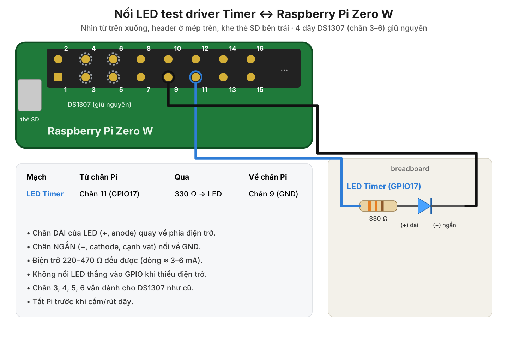

# Custom platform driver for the BCM2835 System Timer (channel 1) – Raspberry Pi Zero W

A **platform driver**: the device is **built into the SoC**, it is described by the **Device Tree**,
and the driver uses the `platform_driver` interface with `probe()` / `remove()`.

| | |
|---|---|
| Hardware | BCM2835 System Timer, `timer@7e003000`, **compare channel 1** |
| Driver | `bcm_timer_plat.c` → `bcm_timer_plat.ko` |
| Overlay | `bcm-timer-plat-overlay.dts` → `bcm-timer-plat.dtbo` |
| `compatible` | `"edu,bcm2835-timer-ch1"` |
| Function | Periodic interrupt (100 µs – 10 s), interrupt counter, interrupt-latency measurement, LED on GPIO17 toggled at every interrupt |

**Relation to the Pi's own timer:** this driver **runs alongside** the system timer; it does not replace it.
The system timer `bcm2835_timer` (channel 3) is built into the kernel and initialised with
`TIMER_OF_DECLARE()` very early at boot, before the `platform_driver` mechanism exists. It is the
"heartbeat" of Linux: scheduling and `sleep` depend on it. Replacing it would require rebuilding the
whole kernel, and a small mistake would leave the Pi unable to boot.

The System Timer has 4 compare channels. According to the kernel Device Tree binding, channels 0 and 2
are used by the GPU and channels 1 and 3 are for the ARM. Linux already uses channel 3, so this driver
uses the free **channel 1**.

| File | Role |
|---|---|
| `bcm_timer_plat.c` | Driver code |
| `bcm-timer-plat-overlay.dts` | Device Tree overlay (adds the `edu-timer` node) |
| `Makefile` | Builds the `.ko` module and the `.dtbo` overlay; `make install` |
| `README.md`, `wiring-led-timer.png` | This guide and the wiring diagram (stay on the PC) |

---

## 1. Components

| Component | Qty |
|---|---|
| Raspberry Pi Zero W with soldered header, Raspberry Pi OS 32-bit | 1 |
| 5 mm LED | 1 |
| 330 Ω resistor (220–470 Ω also works) | 1 |
| Breadboard + 2 female–male jumper wires | |

No separate power supply, capacitor or transistor is needed: the LED draws only 3–6 mA, which a Pi GPIO can supply.

---

## 2. Wiring



| From Pi pin | Through | To Pi pin |
|---|---|---|
| **Pin 11** (GPIO17) | 330 Ω resistor → LED | **Pin 9** (GND) |

1. **Shut down the Pi and unplug it.**
2. Put the LED on the breadboard, each leg in its own row.
3. Identify the legs: **long leg = (+) anode**, **short leg = (−) cathode** (flat side of the plastic rim).
4. One end of the resistor goes in the same row as the long leg; the other end goes to **pin 11**. The short leg goes to **pin 9**.
5. Pins 9 and 11 are on the inner row of the header (pin 1 is the square pad, next to the SD-card slot).
6. Check: LED the right way round, resistor in series, no wire on pins 1, 2 or 4 (power).
7. Plug the power back in.

The four DS1307 wires (pins 3–6) and the PWM LED (pins 12, 14) can stay connected; there is no conflict.

**Test the LED before using the driver** (optional): `pinctrl set 17 op dh` turns the LED on, `pinctrl set 17 op dl` turns it off.
If it does not light, the LED is reversed or a wire is loose. Reboot the Pi after this test, before loading the driver.

---

## 3. Preparing Raspberry Pi OS

Skip this step if it was already done for another driver (RTC, PWM).

```bash
sudo apt update
sudo apt full-upgrade -y
sudo reboot
# after the reboot:
sudo apt install -y build-essential device-tree-compiler linux-headers-rpi-v6
ls -d /lib/modules/$(uname -r)/build      # must exist
```

---

## 4. Copying the code to the Pi

Only **3 files** are needed: `bcm_timer_plat.c`, `bcm-timer-plat-overlay.dts`, `Makefile`.

From the PC (on Windows, open PowerShell in the folder that contains the files):

```bash
ssh <user>@<hostname>.local "mkdir -p ~/Timer"
scp bcm_timer_plat.c bcm-timer-plat-overlay.dts Makefile <user>@<hostname>.local:~/Timer/
```

---

## 5. Build

```bash
cd ~/Timer
make
```

Output: `bcm_timer_plat.ko` (kernel module) and `bcm-timer-plat.dtbo` (compiled overlay).

---

## 6. Loading the overlay and the driver

### Method A (recommended): permanent installation

```bash
sudo make install
sudo nano /boot/firmware/config.txt
```

Add at the **end of the file** (below the `[all]` line):

```
dtoverlay=bcm-timer-plat
```

Save and `sudo reboot`. At boot, udev runs `modprobe bcm_timer_plat` from the `compatible` alias and `probe()` runs.
**The LED starts blinking once per second as soon as the Pi has booted.**

Optional parameters: `dtoverlay=bcm-timer-plat,period_us=100000` (interrupt period at boot), `led_gpio=27` (change the LED pin).

### Method B: temporary loading without a reboot (lost after a reboot)

```bash
cd ~/Timer
sudo dtoverlay -d . bcm-timer-plat
sudo insmod ./bcm_timer_plat.ko
```

---

## 7. Checking that `probe()` ran

```bash
sudo dmesg | grep bcm-timer-plat
```

```
bcm-timer-plat 20003000.edu-timer: System Timer channel 1: IRQ 25, period 500000 us, LED on GPIO, counter 4152622 us
```

The IRQ number and the `counter` value on your Pi will differ.

---

## 8. Testing the driver

Reading files in `/sys` needs no special rights, but **writing** them requires root. Every write therefore has the form:

```bash
echo <value> | sudo tee <file> > /dev/null
```

`sudo tee` writes the value with root rights; `> /dev/null` only stops `tee` from echoing the value.
Do **not** use `sudo echo <value> > <file>`: the `>` is handled by the normal user's shell before `sudo`
runs, so it still fails with `Permission denied`. `rmmod`, `modprobe`, `insmod` and `dmesg` also need `sudo`.

The variable `$T` (the driver's directory in `/sys`) is set in section 8.1. In a new terminal, run that command again first.

The sample outputs below were produced by running exactly these commands on an emulated Pi Zero (section 12).
The error lines are shown as printed by the `tee` of Raspberry Pi OS (`tee: <file>: Invalid argument`).

### 8.1 Driver control directory

```bash
T=$(ls -d /sys/bus/platform/drivers/bcm-timer-plat/*.edu-timer); echo $T; ls $T
```

```
/sys/bus/platform/drivers/bcm-timer-plat/20003000.edu-timer
counter  driver  driver_override  enable  irq_count  max_latency_us  missed
modalias  of_node  period_us  power  subsystem  supplier:platform:20200000.gpio  uevent
```

Attributes created by the driver:

| File | Access | Meaning |
|---|---|---|
| `enable` | read/write | `1` = run, `0` = stop; writing `1` resets the statistics |
| `period_us` | read/write | Interrupt period, 100 – 10 000 000 µs |
| `irq_count` | read | Interrupts since the last `enable` |
| `missed` | read | Periods skipped because the interrupt came too late |
| `max_latency_us` | read | Largest interrupt latency (µs) |
| `counter` | read | 64-bit System Timer counter (µs since power-on) |

### 8.2 Two timer interrupts side by side

```bash
grep -e timer /proc/interrupts
```

```
 25:          0  ARMCTRL-level  33 Edge      20003000.edu-timer
 27:        424  ARMCTRL-level  35 Edge      timer
```

- `ARMCTRL-level 33` = GPU interrupt 1 (32 + 1) = **channel 1, this driver**.
- `ARMCTRL-level 35` = GPU interrupt 3 = **channel 3, the Linux system timer**, still running normally.

Run the command a few times: the counters on both lines increase.

### 8.3 Periodic interrupt every 0.5 s, LED blinking

```bash
cat $T/period_us $T/enable
echo 1 | sudo tee $T/enable > /dev/null; sleep 2; cat $T/irq_count
```

```
500000
1
4
```

The LED changes state at every interrupt, so it blinks once per second. Writing `1` to `enable` resets
`irq_count` to 0, so about 4 interrupts are counted after 2 seconds (2 per second). Reading `irq_count`
without the reset shows a large number (for example 930): the interrupts since the driver was loaded at
boot, 930 interrupts ≈ 7 min 45 s.

### 8.4 Changing the period

```bash
echo 100000 | sudo tee $T/period_us > /dev/null
sleep 1; cat $T/irq_count
```

```
14
```

The LED blinks much faster (5 times per second). `irq_count` is not reset when the period changes
(4 + about 10 = 14); it returns to 0 only when `1` is written to `enable`.

### 8.5 1 kHz interrupts and latency measurement

```bash
echo 1000 | sudo tee $T/period_us > /dev/null; echo 1 | sudo tee $T/enable > /dev/null; sleep 1; cat $T/irq_count $T/missed $T/max_latency_us
```

Result on the real Raspberry Pi Zero W (kernel 6.18.50):

```
1039
0
31
```

- `irq_count` ≈ 1000: 1000 interrupts per second (the extra ones come from the time the commands take).
- `missed`: periods skipped because the interrupt came too late (the driver compensates so the rhythm does not drift).
- `max_latency_us`: the largest delay from the hardware compare match to the entry of the interrupt service routine (ISR).

The LED now toggles 1000 times per second, so it looks **dimly and continuously lit**. To measure under load,
run `yes > /dev/null &`, measure again, then `kill %1`.

### 8.6 Rejecting invalid values

```bash
echo 50 | sudo tee $T/period_us > /dev/null
echo 20000000 | sudo tee $T/period_us > /dev/null
```

```
tee: /sys/bus/platform/drivers/bcm-timer-plat/20003000.edu-timer/period_us: Invalid argument
tee: /sys/bus/platform/drivers/bcm-timer-plat/20003000.edu-timer/period_us: Invalid argument
```

Valid periods are 100 µs to 10 s, so these errors are expected.

### 8.7 Stopping the timer

```bash
echo 0 | sudo tee $T/enable > /dev/null; cat $T/irq_count; sleep 1; cat $T/irq_count
```

```
1045
1045
```

The counter stays constant and the LED is off.

### 8.8 The 64-bit System Timer counter

```bash
cat $T/counter; cat /proc/uptime
```

```
9894455
9.09 4.93
```

`counter` is the number of µs since the SoC was powered on (1 MHz), so it is slightly larger than the
Linux `uptime` (the time the firmware takes to boot).

### 8.9 `remove()` and `probe()`: unload and reload

```bash
echo 500000 | sudo tee $T/period_us > /dev/null; echo 1 | sudo tee $T/enable > /dev/null
sudo rmmod bcm_timer_plat; sudo dmesg | tail -n 1; grep -c edu-timer /proc/interrupts
sleep 1; cat /proc/uptime
```

```
bcm-timer-plat 20003000.edu-timer: removing timer (0 interrupts since last enable)
0
10.35 5.90
```

`remove()` ran: the channel-1 interrupt is gone from `/proc/interrupts` (`0` lines) and the LED is off.
`uptime` still increases, so the system timer is not affected. Reload:

```bash
sudo modprobe bcm_timer_plat          # Method A
# or: sudo insmod ./bcm_timer_plat.ko   (Method B)
sudo dmesg | tail -n 1
```

```
bcm-timer-plat 20003000.edu-timer: System Timer channel 1: IRQ 25, period 500000 us, LED on GPIO, counter 11209957 us
```

`probe()` runs again and the LED blinks again with the default 0.5 s period.

---

## 9. Uninstalling

```bash
sudo nano /boot/firmware/config.txt     # delete the line dtoverlay=bcm-timer-plat
cd ~/Timer && sudo make uninstall && make clean
sudo reboot
```

---

## 10. Troubleshooting

| Symptom | Cause / fix |
|---|---|
| `make`: `/lib/modules/.../build: No such file or directory` | `linux-headers-rpi-v6` not installed, or kernel and headers do not match (`full-upgrade`, then `reboot`). |
| `insmod: ... Invalid module format` | Module built for another kernel. Run `make clean && make` again after the reboot. |
| No `bcm-timer-plat` line in `dmesg` | Overlay not applied. Check `ls /proc/device-tree/soc/ \| grep edu-timer`. With Method B, run `dtoverlay` before `insmod`. |
| `cannot get led-gpios` / `-EBUSY` | GPIO17 is held by another program. Move the LED with `dtoverlay=bcm-timer-plat,led_gpio=27` and wire it to pin 13. |
| LED does not blink but `irq_count` increases | LED reversed, GND missing or wrong pin (must be **pin 11**). |
| `irq_count` stays at 0 | `enable` is 0: `echo 1 \| sudo tee $T/enable`. |
| `... /sys/...: Permission denied` | Writing to `/sys` without root. Use `echo <value> \| sudo tee <file>`, not `echo ... > file` or `sudo echo ... > file`. |

---

## 11. Code explanation

### 11.1 Flow

```
config.txt: dtoverlay=bcm-timer-plat      firmware merges the overlay into the Device Tree
        │
        ▼
New node /soc/edu-timer@7e003000:
    compatible = "edu,bcm2835-timer-ch1";
    reg        = <0x7e003000 0x1c>;     // CS, CLO, CHI, C0..C3
    interrupts = <1 1>;                 // GPU interrupt 1 = channel 1
    led-gpios  = <&gpio 17 0>;
    edu,period-us = <500000>;
        │  kernel creates a platform_device; udev modprobe from alias "of:...Cedu,bcm2835-timer-ch1"
        ▼
platform_driver_register()  ──compatible matches──►  probe(pdev)
        ├─ platform_get_resource() + devm_ioremap()   → map the registers (shared, not requested)
        ├─ platform_get_irq()                          → IRQ number of channel 1
        ├─ devm_gpiod_get_optional("led")             → GPIO17
        ├─ devm_request_irq(bcm_timer_isr)
        └─ set compare C1 = CLO + period              → first interrupt

Every time CLO == C1:  bcm_timer_isr()
        ├─ write 1 to bit M1 of CS (clear the flag)
        ├─ measure latency, increment irq_count, toggle the LED
        └─ C1 = previous deadline + period            → next interrupt

rmmod  ──►  remove()  ──►  stop scheduling, LED off, synchronize_irq()  ──►  devm frees IRQ, GPIO, iomap
```

### 11.2 Key technical points

| Point | Implementation |
|---|---|
| New node, original node untouched | The overlay adds `edu-timer@7e003000` under `&soc`; Linux's `timer@7e003000` node is not modified. |
| Shared register block | The System Timer block is shared with the system timer, so the driver uses `devm_ioremap()` (map only) and **not** `request_mem_region()`. |
| Safe flag clearing | `CS` is *write-1-to-clear*: only bit `M1` is written, so the flags of channel 3 (Linux) and channels 0, 2 (GPU) are never cleared by mistake. |
| No drift | Next deadline = previous deadline + period (not counted from ISR entry). If the deadline has already passed, the driver restarts from now and increments `missed`. |
| Latency measurement | In the ISR: `CLO − compare value` = time from the hardware match to ISR entry; the maximum is kept in `max_latency_us`. |
| Stale interrupt when re-arming | When a new deadline is set (period change, re-enable), the old match flag is cleared; the ISR ignores a match that comes before the pending deadline. |
| 32-bit counter wrap | Comparisons use the signed difference `(s32)(now − next)`, so they stay correct when `CLO` wraps (about every 71 minutes). |
| Synchronisation | A `spinlock` between the ISR and the sysfs functions; the 64-bit counter is read under the lock (32-bit ARM cannot read 64 bits at once). |
| GPIO in hard IRQ | `gpiod_cansleep()` is checked in `probe()`: BCM2835 GPIOs do not sleep, so the LED can be toggled inside the ISR. |
| `remove()` | Stops scheduling, clears the flag, turns the LED off, `synchronize_irq()` waits for a running ISR; then devm frees the IRQ and GPIO. |

---

## 12. Testing done

The code was first tested with the **real Raspberry Pi kernel** (`raspberrypi/linux` sources, `bcmrpi_defconfig`
for Pi Zero / Zero W, ARMv6) on an **emulated Pi Zero** (QEMU 10.2, `raspi0` machine, with per-channel System
Timer interrupts and GPIO), then on the **real Raspberry Pi Zero W** (kernel 6.18.50+rpt-rpi-v6).

| Item | Result |
|---|---|
| Build with Pi kernels **6.6**, **6.12**, **6.18** (`W=1`) | No warnings |
| `checkpatch.pl` | 0 errors; only warnings about `LINUX_VERSION_CODE` (intentional, to support several kernel versions) |
| Overlay merged into `bcm2708-rpi-zero-w.dtb` (Raspberry Pi `dtmerge`) | `edu-timer` node with interrupt `<1 1>` and LED GPIO17; `period_us`, `led_gpio` parameters applied correctly |
| All commands of sections 7 → 8, in order | Results as described |
| Overlay loaded at boot and at run time (configfs, as `dtoverlay` does) | `probe()` succeeds; removing the overlay at run time calls `remove()` |
| Channel-1 interrupt alongside the channel-3 system timer | `uptime` stays correct while the driver is loaded/unloaded; the GPIO17 LED toggles at every interrupt |
| 100 µs period (10 kHz) | Stable, no kernel errors |
| Real Pi Zero W at 1 kHz | 1039 interrupts in about 1 s, 0 missed periods, 31 µs worst-case latency |
